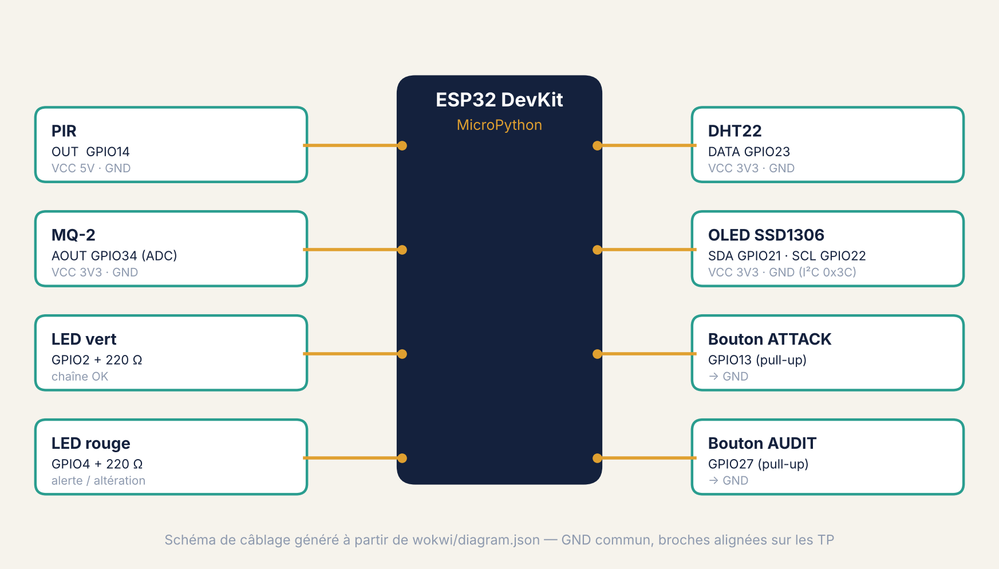

# CAIRN — a tamper-evident black box for home-security events (MicroPython · ESP32 · Wokwi)

> *A cairn is a stack of stones that marks a path: each stone rests on the previous one. CAIRN does the same with sensor events.*

**Problem.** After a break-in, a gas leak or a fire, the records of a home alarm are the evidence — for the owner, the insurer, the police. But on a cheap connected device those records are plain files: whoever reaches the device can edit or delete the line that incriminates them, or feed the sensors fake values.

**CAIRN** is a MicroPython firmware (ESP32) that
1. **gates** raw sensor readings with lightweight plausibility rules (temperature jumps, gas spikes/thresholds, PIR flooding),
2. **seals** every event in an append-only **hash chain**, authenticated with **HMAC-SHA256** under a **forward-secure key ratchet**,
3. exposes **anchors** (`seq`, `head hash`) to keep off-device, and
4. ships an **offline verifier** that localises the first altered record.

Everything runs in the [Wokwi](https://wokwi.com) ESP32 simulator — no hardware needed.

[](https://amalkaraoud.github.io/Cairn-repo/) [](https://wokwi.com/projects/480885243109700609)

**Interactive web demo (real SHA-256/HMAC chain, attacks, audit):** [https://amalkaraoud.github.io/Cairn-repo/](https://amalkaraoud.github.io/Cairn-repo/)  
**Live simulation (working project, circuit + firmware preloaded):** [https://wokwi.com/projects/480885243109700609](https://wokwi.com/projects/480885243109700609)



## What it detects — and what it does not

| Attack on the log file | Chain only | Chain + HMAC | + external anchor |
|---|:--:|:--:|:--:|
| Edit a record | ✅ | ✅ | ✅ |
| Delete / insert / reorder | ✅ | ✅ | ✅ |
| Edit **and recompute hashes** (no key) | ❌ | ✅ | ✅ |
| Truncate the tail | ❌ | ❌ | ✅ |
| Attacker holds the **current** key (append forged records) | ❌ | ❌ | ❌ |

Measured on synthetic logs, 300 trials per attack, on a host computer (`experiments/`). These rates follow from the construction (they are deterministic properties), so they mainly show that the implementation behaves as designed. The last row is a **documented limit**, not a bug: see [docs/THREAT_MODEL.md](docs/THREAT_MODEL.md).

## Repository layout

```
index.html    interactive web demo (served by GitHub Pages)
firmware/     MicroPython code (flat layout: copy all files to the board / Wokwi)
wokwi/        diagram.json (circuit)
tools/        verify.py — offline verifier
tests/        unit tests (host, CPython)
experiments/  reproducible experiments + results
docs/         architecture, threat model, related work, Wokwi guide
```

## Quick start

**Host tests & experiments (CPython ≥ 3.8, no dependencies except matplotlib for figures):**
```bash
python3 -m unittest discover -s tests -v
python3 experiments/run_experiments.py      # writes experiments/results/results.json
```

**Simulator:** open the [live Wokwi project](https://wokwi.com/projects/480885243109700609) and press ▶, or see [docs/WOKWI_GUIDE.md](docs/WOKWI_GUIDE.md) to rebuild it (create an ESP32 MicroPython project, paste `diagram.json`, add the files from `firmware/`, press ▶).

**Verify a log exported from the simulator** (press AUDIT; copy the serial terminal to `dump.txt`):
```bash
python3 tools/verify.py --log dump.txt --key-hex $(python3 -c "import sys; sys.path.insert(0,'firmware'); import keys_demo; print(keys_demo.K0_HEX)") --anchor 10:<hash printed by the ANCHOR line>
```

## Status (v0.1.0 — prototype)

| Item | Status |
|---|---|
| Hash chain, HMAC, ratchet, verifier | ✅ unit-tested on host (16 tests) |
| Plausibility rules | ✅ unit-tested + synthetic experiments (host) |
| Full firmware run in Wokwi | ✅ imported and run in Wokwi ([project](https://wokwi.com/projects/480885243109700609)): circuit renders, Wi-Fi/NTP sync, events sealed and logged (e.g. `GAS_ALARM`). The ATTACK/AUDIT button flow is still to be re-checked by the author |
| ESP32 hardware | ❌ never run on real hardware |
| Log rotation, flash-wear management, secure key storage | ❌ not implemented (see limits) |

## Limits (read before trusting it)
* HMAC key lives on the device (`cairn.state` holds the *current* ratcheted key). Real deployments need flash encryption / secure element.
* The on-device self-audit is **not** a trust anchor; an attacker who controls the device can bypass it. Trust comes from the offline verifier + an anchor stored elsewhere.
* The demo key in `firmware/keys_demo.py` is public by design.
* Plausibility rules are heuristics tuned on synthetic data; real sensors will need calibration.

## Related work and positioning
Hash-chained and MAC-sealed logs are well known (Schneier & Kelsey 1999; EmLog; Merkle-tree IoT pipelines; many libraries). CAIRN is an **adaptation and combination** for MicroPython/ESP32 with a plausibility gate in front of the log and a fully simulated, reproducible demo. No MicroPython-specific equivalent was found in a limited search (see [docs/RELATED_WORK.md](docs/RELATED_WORK.md)); that is absence of evidence, not proof of novelty.

## License
MIT — see [LICENSE](LICENSE). Author: Amal Karaoud.
